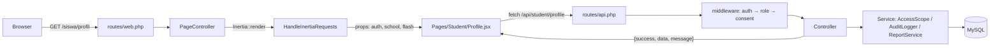

# SADAR DIRI — Dokumentasi Proyek

Sistem Informasi dan Portofolio Diri untuk mendukung kesejahteraan psikologis siswa (SMA/SMK). Aplikasi menjadi kanal journaling emosi, refleksi, portofolio prestasi, dan perencanaan masa depan bagi siswa, sekaligus alat pemantauan dini dan pendampingan bagi Guru BK.

Dokumen ini menjelaskan kondisi kode saat ini: arsitektur, model data, seluruh endpoint, aturan bisnis, keputusan privasi, dan cara menjalankan. Ditulis dari pembacaan langsung kode pada commit `1abfc6c` (branch `main`).

---

## 1. Ringkasan

| Aspek | Keterangan |
|---|---|
| Nama aplikasi | SADAR DIRI |
| Domain produksi | `sadar-diri.my.id` (email pengirim `notifikasi@sadar-diri.my.id`) |
| Jenis | Aplikasi web monolit Laravel + Inertia/React (SPA tanpa API terpisah) |
| Basis pengguna | Siswa, Guru BK, Superadmin |
| Bahasa antarmuka | Bahasa Indonesia (seluruh teks, pesan validasi, dan pesan error) |
| Jumlah route | 166 (128 di antaranya di bawah prefix `api/`) |
| Jumlah tabel | 42 (33 tabel aplikasi + 9 tabel framework: users/reset/sessions, cache, jobs, notifications) |
| Cakupan tes | 33 tes fitur + 1 tes unit (34 total) |

Tujuan produk, sesuai pemetaan ke enam dimensi kesejahteraan Ryff: penerimaan diri, relasi positif, kemandirian, penguasaan diri, tujuan hidup, dan pertumbuhan.

---

## 2. Peran dan hak akses

| Peran | Kode | Portal | Ringkasan akses |
|---|---|---|---|
| Siswa | `student` | `/siswa/*` | Biodata & profil diri, mood, jurnal, portofolio prestasi, refleksi, rencana aksi & rencana masa depan, pengaturan privasi & akun |
| Guru BK | `counselor` | `/bk/*` | Dashboard kelas binaan, alert risiko, detail siswa, baca jurnal + balas, catatan konseling, sesi refleksi terbimbing + umpan balik, verifikasi prestasi, laporan kelas (CSV/PDF) |
| Superadmin | `superadmin` | `/admin/*` | Pengguna & impor CSV, kelas, tahun ajaran & kenaikan kelas, konten & versi, pengumuman, laporan agregat, audit log, retensi, pengaturan sekolah. **Tidak punya rute untuk membaca konten psikologis.** |

Status akun: `pending`, `active`, `inactive`, `archived`, `alumni`. Hanya `active` yang boleh masuk. Akun baru dari halaman Pengguna maupun impor CSV langsung dibuat `active` dengan kata sandi awal yang ditentukan admin (impor: kolom opsional `password`, jika kosong memakai NIS/NIP). Alur undangan aktivasi via email sudah dihapus.

### Batas akses yang ditegakkan kode

- **Guru BK ↔ siswa**: `App\Services\AccessScope::counselorCanAccess()` hanya mengizinkan siswa yang **pernah atau sedang** berada di kelas yang ditugaskan ke guru BK tersebut (`counselor_class` → `class_student`). Tidak ada penugasan = tidak ada akses.
- **Superadmin ↔ konten psikologis**: tidak ada route jurnal/refleksi/catatan konseling di grup `admin`. Diuji oleh `AccessControlTest::test_superadmin_cannot_read_journals`.
- **Siswa**: seluruh route siswa memakai middleware `role:student`, dan route bertanda konsen memakai `consent:journaling` / `consent:portfolio` / `consent:reflection`.
- **Guru BK mengubah profil siswa**: diperbolehkan (biodata & profil diri) dan setiap perubahan menghasilkan versi baru + audit log.

---

## 3. Stack

| Lapisan | Teknologi | Versi |
|---|---|---|
| Bahasa | PHP | `^8.3` |
| Framework | Laravel | `^13.17` |
| Jembatan SPA | Inertia Laravel / `@inertiajs/react` | `^3.5` / `^3.9` |
| UI | React + React DOM | `^19.3` |
| Build | Vite + `laravel-vite-plugin` | `^8.0` / `^3.1` |
| CSS | Tailwind CSS (`@tailwindcss/vite`) | `^4.0` |
| Database | MySQL / MariaDB | — |
| PDF | `barryvdh/laravel-dompdf` | `^3.1` |
| Email | `resend/resend-php` | `^1.16` |
| Redis (opsional) | `predis/predis` | `^3.7` |
| Dev | PHPUnit 12, Pint, Collision, Pail, Tinker | — |

Catatan: tidak ada Sanctum/Passport. Autentikasi memakai **session cookie Laravel**; `routes/api.php` dipasang di dalam grup middleware `web` (lihat `bootstrap/app.php`), sehingga CSRF dan session berlaku untuk semua panggilan `fetch`.

---

## 4. Arsitektur

### 4.1 Dua lapis routing

```
routes/web.php   → halaman Inertia (render React) + tautan aktivasi bertanda tangan
routes/api.php   → 128 endpoint JSON, di-mount pada prefix /api dengan middleware web
routes/console.php → 4 perintah artisan + jadwal
```

`bootstrap/app.php` memakai `withRouting(... then: ...)` untuk menambahkan `routes/api.php` dengan `Route::middleware('web')->prefix('api')`. Konsekuensinya: tidak ada token bearer; identitas datang dari session.

### 4.2 Alur permintaan



### 4.3 Bentuk respons API

Sukses:

```json
{ "success": true, "data": { }, "message": "Opsional." }
```

Gagal:

```json
{
  "success": false,
  "error": "INVALID_CREDENTIALS",
  "message": "Identitas atau kata sandi salah.",
  "errors": { "field": ["Pesan validasi."] }
}
```

`resources/js/lib/api.js` menormalkan semuanya: respons non-2xx atau `success === false` dilempar sebagai `ApiError` dengan `.status`, `.payload`, dan `.details` (= `payload.details ?? payload.errors`). Komponen memakai `error.details` untuk menempelkan pesan ke field.

### 4.4 Middleware

| Alias | Kelas | Perilaku |
|---|---|---|
| `role` | `EnsureRole` | 401/redirect bila belum login; logout paksa + 403 `ACCOUNT_INACTIVE` bila status ≠ `active`; 403 `FORBIDDEN` bila peran tidak cocok |
| `consent` | `EnsureConsent` | Siswa tanpa konsen → 403 `CONSENT_REQUIRED`; fitur dimatikan lewat setting → 403 `FEATURE_DISABLED` |
| `twofactor` | `EnsureTwoFactor` | Superadmin tanpa flag session `two_factor_passed` → 403 `TWO_FACTOR_REQUIRED` |
| — | `HandleInertiaRequests` | Membagikan `auth.user` (id, name, email, role, status, identity_number, avatar_url, has_consent), `school`, dan `flash` |

### 4.5 Struktur direktori

```
app/
  Http/Controllers/
    AuthController.php            login, logout, me, reset, aktivasi, konsen, OTP
    PageController.php            render halaman Inertia per peran
    AttachmentController.php      unduh lampiran (signed URL)
    NotificationController.php    notifikasi in-app + pengumuman
    Admin/                        AdminController, UserController, ClassController,
                                  AcademicYearController, ContentController,
                                  AnnouncementController, RetentionController
    Counselor/                    CounselorController, AlertController,
                                  CounselingNoteController, ReflectionSessionController,
                                  AchievementController, ReportController
    Student/                      StudentController, MoodController, JournalController,
                                  ReflectionController, AchievementController,
                                  ActionPlanController
  Models/                         34 model Eloquent
  Services/                       AccessScope, AlertEngine, AuditLogger, EmailOtpService,
                                  ImportService, NotificationService, ReportService,
                                  RetentionService, SettingsService
  Http/Middleware/                EnsureRole, EnsureConsent, EnsureTwoFactor,
                                  HandleInertiaRequests
  Mail/                           LoginOtpMail, PasswordResetMail
  Notifications/                  AppNotification
resources/
  css/app.css                     token @theme + kelas .sd-* (847 baris)
  js/app.jsx                      entry Inertia
  js/Layouts/                     AppShell.jsx, AuthLayout.jsx
  js/Components/                  UI.jsx (30 komponen), Icons.jsx (27 ikon inline)
  js/lib/                         api.js, format.js
  js/Pages/                       31 halaman (Admin 10, Auth 5, Counselor 8,
                                  Onboarding 1, Student 7)
  views/                          app.blade.php, pdf/class-report.blade.php
database/
  migrations/                     8 migrasi
  seeders/                        DatabaseSeeder, DemoSeeder, AcademicYearSeeder,
                                  ActivitySeeder, ContentSeeder, SettingsSeeder,
                                  SuperadminSeeder
tests/Feature/                    5 berkas, 33 tes
routes/                           web.php, api.php, console.php
```

---

## 5. Model data

Skema utama ada di `database/migrations/2026_10_19_000001_create_sadar_diri_schema.php` (31 tabel), ditambah tabel framework dan dua migrasi lanjutan.

### 5.1 Identitas & struktur sekolah

| Tabel | Kolom penting | Catatan |
|---|---|---|
| `users` | `name`, `email` (unik, nullable), `identity_number` (unik, NIS/NIP), `password`, `role`, `status`, `must_change_password`, `consent_version`, `consented_at`, `last_login_at`, `last_activity_at`, `deactivated_at`, `anonymized_at`, `mood_reminder_enabled`, `mood_reminder_hour` (default 19), `reflection_reminder_enabled`, `notification_channel` | `password` di-cast `hashed` → jangan panggil `Hash::make` saat menulis |
| `academic_years` | `name` (mis. `2026/2027`), `starts_on`, `ends_on`, `is_active` | Satu tahun ajaran aktif |
| `classes` | `academic_year_id`, `name`, `level`, `homeroom_teacher_name`, `is_active` | Unik per (`academic_year_id`, `name`) |
| `class_student` | `class_id`, `student_id`, `academic_year_id`, `joined_at`, `left_at`, `status` (`active`/`moved`/`graduated`) | Riwayat keanggotaan; dasar `AccessScope` |
| `counselor_class` | `counselor_id`, `class_id`, `assigned_at` | Penugasan Guru BK ke kelas |

### 5.2 Profil siswa

| Tabel | Kolom penting | Enkripsi |
|---|---|---|
| `student_profiles` | `birth_date`, `gender`, `address`, `phone`, `height_cm`, `weight_kg`, `blood_type`, `medical_history`, `health_notes`, `psychological_summary`, `character_summary`, `strengths`, `weaknesses`, `completeness_percent`, `published_at`, `version` | `medical_history`, `health_notes`, `psychological_summary`, `character_summary`, `strengths`, `weaknesses` |
| `student_profile_versions` | `student_profile_id`, `version`, `snapshot` (JSON), `created_by` | — |

`completeness_percent` dihitung dari kelengkapan biodata; `published_at` menandai profil diri sudah dibagikan ke Guru BK (sebelumnya draf).

### 5.3 Jurnal, mood, refleksi

| Tabel | Kolom penting | Enkripsi |
|---|---|---|
| `mood_entries` | `student_id`, `entry_date`, `valence` (`positive`/`negative`), `intensity` (1–5), `emotion_tags` (JSON), `note` | Tidak (dipakai agregasi) |
| `journal_entries` | `type` (`abc`/`grateful`), `entry_date`, `prompt_content_id`, `activating_event`, `belief`, `consequence`, `gratitude_text`, `happiness_text`, `status` (`draft`/`published`), `is_flagged`, `flagged_at`, `follow_up_requested`, `follow_up_requested_at` | 5 kolom teks jurnal |
| `journal_replies` | `journal_entry_id`, `counselor_id`, `content` | `content` |
| `reflection_sessions` | `counselor_id`, `class_id`/`student_id`, `topic`, `instructions`, `questions` (JSON), `due_at`, `status` (`scheduled`/`ongoing`/`completed`/`cancelled`), `extended_at`, `extension_reason` | — |
| `reflections` | `type` (`self`/`guided`), `week_start`, `positive_experience`, `negative_experience`, `answers`, `status` (`draft`/`submitted`/`late`), `submitted_at` | 2 teks + `answers` (`encrypted:array`) |
| `reflection_feedbacks` | `reflection_id`, `counselor_id`, `content`, `version` | Tidak |

Unik: satu mood per siswa per hari; satu refleksi mandiri per (`student_id`, `type`, `week_start`); satu refleksi per (`student_id`, `session_id`).

### 5.4 Portofolio & rencana

| Tabel | Kolom penting | Catatan |
|---|---|---|
| `achievements` | `category` (`academic`/`non_academic`/`competition`/`soft_skill`), `title`, `organizer`, `level`, `achieved_at`, `rank`, `description`, `verification_status` (`pending`/`verified`/`rejected`), `verified_by`, `verified_at`, `rejection_reason`, `created_by` | Prestasi buatan Guru BK langsung berstatus verified |
| `attachments` | `achievement_id`, `uploaded_by`, `disk`, `path`, `original_name`, `mime_type`, `size_bytes`, `checksum` | Diunduh lewat signed URL `GET /api/attachments/{attachment}` |
| `action_plans` | `student_id`, `period_start`, `period_end`, `status` (`active`/`closed`) | Satu per periode |
| `action_targets` | `action_plan_id`, `title`, `success_indicator`, `status` (`not_started`/`in_progress`/`achieved`/`not_achieved`), `progress_note`, `sort_order` | — |
| `action_evaluations` | `action_plan_id` (unik), `snapshot` (JSON), `evaluation_text`, `improvement_text` | 2 teks dienkripsi |
| `future_plans` | `student_id` (unik), `dream`, `career_plan`, `education_plan`, `concrete_targets` | Semua dienkripsi |
| `future_plan_versions` | `future_plan_id`, `version`, `snapshot` | — |

### 5.5 Pendampingan & pemantauan

| Tabel | Kolom penting | Catatan |
|---|---|---|
| `counseling_notes` | `student_id`, `counselor_id`, `title`, `occurred_at`, `summary`, `content`, `status` (`open`/`closed`), `is_sensitive`, `visible_to_student` | `content` dienkripsi; siswa hanya melihat catatan yang `visible_to_student` |
| `counseling_note_versions` | `counseling_note_id`, `version`, `snapshot`, `changed_by` | Jejak revisi |
| `alerts` | `student_id`, `trigger_type` (`mood_low_streak`/`risk_keyword`/`inactivity`/`reflection_overdue`), `severity` (`low`/`medium`/`high`), `status` (`new`/`in_progress`/`resolved`), `detected_at`, `handled_by`, `handled_at`, `resolution_note`, `dedupe_key` (unik) | `dedupe_key` mencegah alert ganda |

### 5.6 Tata kelola

| Tabel | Kolom penting |
|---|---|
| `audit_logs` | `actor_id`, `action`, `entity_type`, `entity_id`, `subject_user_id`, `reason`, `ip_address`, `user_agent`, `metadata` (JSON), `created_at` |
| `settings` | `key`, `value`, `group`, `type` (`string`/`boolean`/`integer`/`json`), `updated_by` |
| `settings_versions` | `setting_key`, `old_value`, `new_value`, `changed_by` |
| `content_items` | `type` (`abc_prompt`/`reflection_question`/`emotion_category`/`tip_article`), `title`, `slug`, `body`, `metadata`, `version`, `status` (`draft`/`published`/`archived`), `published_at`, `created_by` |
| `content_item_versions` | `content_item_id`, `version`, `snapshot`, `created_by` |
| `announcements` | `title`, `body`, `audience` (`all`/`role`/`class`), `audience_role`, `audience_class_id`, `status`, `published_at`, `expires_at`, `created_by` |
| `consent_records` | `user_id`, `version`, `accepted_at`, `ip_address`, `user_agent`, `revoked_at` |
| `import_batches` / `import_batch_rows` | `filename`, `disk_path`, `total_rows`, `success_rows`, `failed_rows`, `status`, `error_report_path`, `finished_at` / `row_number`, `payload`, `status`, `error_message` |
| `login_attempts` | `identity`, `ip_address`, `successful`, `attempted_at` |
| `login_otp_codes` | `user_id`, `code_hash`, `ip_address`, `expires_at`, `consumed_at` |

---

## 6. Endpoint API

Prefix `/api`. Semua respons memakai envelope `success/data/message`.

### 6.1 Publik

| Method | Path | Keterangan |
|---|---|---|
| GET | `/api/public/school` | Profil sekolah dari settings + tahun ajaran aktif |
| GET | `/api/public/consent/{version}` | Teks persetujuan pemrosesan data |

### 6.2 Autentikasi

| Method | Path | Throttle | Keterangan |
|---|---|---|---|
| POST | `/api/auth/login` | `10,1` | Login via email **atau** NIS/NIP; 5 percobaan/menit per identity+IP; superadmin menerima OTP |
| POST | `/api/auth/forgot-password` | `5,15` | Kirim tautan reset; tidak membocorkan keberadaan akun |
| POST | `/api/auth/reset-password` | `10,15` | Atur ulang dengan token; aturan sandi sama dengan ganti sandi siswa |
| POST | `/api/auth/logout` | — | Catat audit, hapus sesi |
| GET | `/api/auth/me` | — | Payload pengguna + izin |
| POST | `/api/auth/consent` | — | Catat persetujuan (versi, IP, UA) |
| DELETE | `/api/auth/consent` | — | Cabut persetujuan |
| POST | `/api/auth/2fa/verify` | `10,1` | Verifikasi OTP 6 digit |
| POST | `/api/auth/2fa/resend` | `6,1` | Kirim ulang OTP (cooldown 60 detik) |

### 6.3 Siswa (`role:student`)

| Method | Path | Keterangan |
|---|---|---|
| GET | `/api/student/dashboard` | Mood hari ini, streak jurnal, target aktif, pengumuman |
| GET | `/api/student/profile` | `biodata`, `self_profile`, `completeness_percent` |
| PUT | `/api/student/profile/biodata` | Field tertutup (daftar tetap); mengabaikan field lain |
| PUT | `/api/student/profile/self` | Simpan draf atau publikasikan (`publish`), menaikkan `version` |
| PUT | `/api/student/account/password` | `throttle:10,1` — ganti sandi mandiri, wajib `current_password` |
| GET | `/api/student/profile/versions` | Riwayat versi profil diri |
| GET | `/api/student/counseling-summaries` | Ringkasan catatan konseling yang boleh dilihat |
| GET | `/api/student/privacy/access-log` | Jejak akses Guru BK ke data siswa |
| GET/PUT | `/api/student/preferences/reminders` | Preferensi pengingat mood/refleksi |
| POST | `/api/student/whatsapp-link` | Tautan eskalasi WhatsApp (bila fitur aktif) |
| — | `/api/student/moods`, `/moods/summary` | `consent:journaling` |
| — | `/api/student/journals` (+ `draft`, `{journal}` GET/PUT/DELETE) | `consent:journaling` |
| — | `/api/student/reflections`, `/reflection-sessions`, `/{session}/submit` | `consent:journaling` |
| — | `/api/student/achievements` (+ upload/hapus lampiran, `export`) | `consent:portfolio` |
| — | `/api/student/action-plans/*`, `/future-plan` | Rencana aksi, target, evaluasi, rencana masa depan |

### 6.4 Guru BK (`role:counselor`)

| Method | Path | Keterangan |
|---|---|---|
| GET | `/api/counselor/dashboard` | Ringkasan kelas binaan |
| GET | `/api/counselor/students` | Daftar siswa dalam lingkup akses |
| GET | `/api/counselor/students/{student}/overview` | Profil + ringkasan aktivitas |
| GET | `/api/counselor/students/{student}/journals` | Jurnal siswa (terenkripsi saat dibaca) |
| GET | `/api/counselor/students/{student}/reflections` | Refleksi siswa |
| GET/POST | `/api/counselor/students/{student}/achievements` | Lihat / tambah prestasi (langsung verified) |
| PUT | `/api/counselor/students/{student}/profile/biodata`, `/self` | Ubah profil siswa + versi baru |
| GET | `/api/counselor/students/{student}/action-plan` | Rencana aksi & masa depan |
| POST | `/api/counselor/journals/{journal}/replies` | Balas jurnal (audit + notifikasi) |
| GET | `/api/counselor/students/{student}/access-logs` | Jejak akses |
| PUT | `/api/counselor/preferences/notifications` | Kanal notifikasi |
| GET/PATCH | `/api/counselor/alerts`, `/alerts/{alert}` | Daftar & tindak lanjut alert |
| GET/POST/GET/PUT | `/api/counselor/counseling-notes` (+ `/{note}`) | Catatan konseling |
| GET/POST/GET/PATCH | `/api/counselor/reflection-sessions` (+ `/{session}`) | Sesi refleksi terbimbing |
| POST | `/api/counselor/reflections/{reflection}/feedback` | Umpan balik |
| GET | `/api/counselor/achievements/pending` | Antrean verifikasi |
| POST | `/api/counselor/achievements/{achievement}/verify` | Verifikasi / tolak |
| GET | `/api/counselor/reports/class`, `/reports/class/export` | Laporan kelas (`pdf` atau `csv`) |

### 6.5 Superadmin (`role:superadmin` + `twofactor`)

| Method | Path | Keterangan |
|---|---|---|
| GET | `/api/admin/dashboard` | Counter sistem |
| GET | `/api/admin/reports/aggregate`, `/export` | Agregat lintas kelas (kelas <10 siswa disembunyikan) |
| GET/PUT | `/api/admin/settings` | Pengaturan sekolah (berversi) |
| GET | `/api/admin/audit-logs` | Audit log |
| GET | `/api/admin/classes/options` | Opsi kelas |
| GET/POST | `/api/admin/users`, `/users/import`, `/users/{user}` | CRUD pengguna & impor CSV. Daftar: paginasi `page`/`per_page` (default 20, maksimum 100), akun `superadmin` selalu dikecualikan |
| PATCH | `/api/admin/users/{user}/status` | Ubah status |
| POST | `/api/admin/users/{user}/reset-password` | Reset sandi (wajib alasan, kirim email) |
| POST | `/api/admin/users/{user}/force-logout` | Paksa logout |
| POST | `/api/admin/users/{user}/anonymize` | Anonimisasi |
| CRUD | `/api/admin/classes/*` | Kelas + penugasan siswa & Guru BK |
| POST | `/api/admin/counselors/{counselor}/classes` | Tugaskan satu Guru BK ke banyak kelas sekaligus (`class_ids[]`) |
| CRUD | `/api/admin/academic-years/*` | Tahun ajaran, aktivasi, kenaikan kelas |
| CRUD | `/api/admin/content/*` | Konten + publish + rollback versi |
| CRUD | `/api/admin/announcements/*` | Pengumuman |
| GET/POST | `/api/admin/retention/preview`, `/run` | Pratinjau & eksekusi retensi |

### 6.6 Bersama (semua peran login)

| Method | Path | Keterangan |
|---|---|---|
| GET | `/api/notifications` | Notifikasi in-app |
| POST | `/api/notifications/read-all`, `/notifications/{id}/read` | Tandai dibaca |
| GET | `/api/announcements` | Pengumuman yang berlaku |
| GET | `/api/attachments/{attachment}` | Unduh lampiran — **signed URL** |

### 6.7 Halaman web

| Path | Peran | Halaman React |
|---|---|---|
| `/` | publik | Landing |
| `/masuk`, `/lupa-sandi`, `/reset-password` | guest | `Auth/Login`, `Auth/Forgot`, `Auth/Reset` |
| `/aktivasi/{user}` | signed URL | `Auth/Activate` |
| `/2fa/challenge` | auth | `Auth/TwoFactor` |
| `/onboarding/consent` | auth | `Onboarding/Consent` |
| `/siswa/beranda` … `/siswa/privasi` | siswa | Dashboard, Profile, Journal, Portfolio, Reflection, Plan, Privacy |
| `/bk/dashboard` … `/bk/laporan` | Guru BK | Dashboard, Alerts, Students, StudentDetail, Reflections, Verification, Notes, Reports |
| `/admin/dashboard` … `/admin/retensi` | superadmin + 2FA | Dashboard, Users, Classes, AcademicYears, Content, Settings, Audit, Reports, Announcements, Retention |

---

## 7. Aturan bisnis

### 7.1 Autentikasi & sesi

- Login menerima **email atau NIS/NIP** pada field `identity`.
- Pembatasan: `RateLimiter` 5 percobaan/menit per `identity|IP`, ditambah `throttle:10,1` pada route. Setiap percobaan dicatat di `login_attempts`.
- Password diverifikasi dengan `Hash::check`; cast `hashed` menangani penulisan.
- Setelah login: `session()->regenerate()`, `last_login_at`/`last_activity_at` diperbarui, audit `auth.login`.
- **2FA hanya untuk superadmin** (`requiresTwoFactor()` = `isSuperadmin()`). Kode 6 digit, TTL 10 menit, sekali pakai, cooldown kirim ulang 60 detik, disimpan sebagai hash di `login_otp_codes`. Keberhasilan menandai session `two_factor_passed`.
- Akun non-`active` tidak bisa login. Akun baru dibuat langsung `active` dengan kata sandi awal dari admin, sehingga tidak ada lagi alur aktivasi lewat tautan bertanda tangan.
- Reset sandi: tautan via email; respons selalu sama untuk email tidak dikenal (anti-enumerasi).

### 7.2 Ganti kata sandi mandiri (siswa)

- Endpoint: `PUT /api/student/account/password` (`throttle:10,1`).
- Wajib `current_password` yang benar → jika salah: 422 `INVALID_PASSWORD`, `errors.current_password[0]`.
- Sandi baru: `min:10`, harus memuat huruf kecil, huruf besar, dan angka, serta `confirmed`.
- Sukses menyetel `must_change_password = false` dan mencatat audit `auth.password_changed`.
- **Email tidak dapat diubah siswa.** Kartu "Akun & keamanan" hanya menampilkan email (`ReadOnlyValue`) dengan panduan menghubungi Guru BK. Perubahan email tetap milik admin/Guru BK lewat `Admin/Users.jsx`. Ini keputusan produk: mencegah pengambilalihan akun dari sesi yang ditinggal terbuka.

### 7.3 Konsen & fitur bertanda

- Konsen disimpan ganda: kolom `users.consent_version`/`consented_at` dan riwayat `consent_records`.
- Middleware `consent:<feature>` memeriksa (a) siswa sudah konsen, (b) flag fitur di settings (`feature.journaling`, `feature.portfolio`, `feature.reflection`).
- Pencabutan konsen mengisi `revoked_at` dan mengosongkan kolom konsen pengguna; fitur bertanda langsung tertutup.

### 7.4 Alert otomatis (`AlertEngine`)

| Trigger | Ambang | Severity |
|---|---|---|
| `mood_low_streak` | ≥3 hari berturut-turut mood `negative` dengan intensitas ≥4, dihitung dari hari ini mundur, minimal 3 entri dalam 10 hari | `high` bila intensitas terakhir 5, selain itu `medium` |
| `risk_keyword` | Jurnal 3 hari terakhir yang belum ditandai (`is_flagged = false`) memuat salah satu dari 8 frasa: menyakiti diri, bunuh diri, ingin mati, tidak ingin hidup, mengakhiri hidup, self harm, melukai diri, putus asa. Entri lalu ditandai `is_flagged` + `flagged_at` | `high` |
| `inactivity` | Tidak ada aktivitas selama ≥14 hari (`last_activity_at`) | `low` |
| `reflection_overdue` | Sesi refleksi untuk siswa/kelasnya sudah lewat `due_at` dan belum ada kiriman (`submitted`/`late`) | `medium` |

Setiap alert memakai `dedupe_key` berformat `{student_id}:{trigger_type}:{YYYY-MM-DD}` sehingga satu jenis alert per siswa per hari, mencatat audit `alert.created`, dan hanya alert baru (`wasRecentlyCreated`) yang memicu notifikasi: ke Guru BK kelas terkait, dan untuk severity `high` ke **seluruh** Guru BK aktif.

### 7.5 Jurnal

- Dua tipe: `abc` (Activating event, Belief, Consequence) dan `grateful` (syukur + kebahagiaan).
- Status `draft` → `published`. Draf hanya terlihat siswa.
- Siswa dapat menandai `follow_up_requested` (minta konseling) atau **tidak**; Guru BK tetap dapat membaca jurnal meski tanpa permintaan tindak lanjut.
- Guru BK membalas lewat `journal_replies`; balasan terenkripsi dan memicu notifikasi ke siswa.
- Semua isi jurnal dienkripsi di database dengan `APP_KEY`.

### 7.6 Refleksi

- **Mandiri**: satu entri per pekan (`week_start`), diisi siswa kapan saja.
- **Terbimbing**: Guru BK membuat `reflection_sessions` (target kelas atau siswa, `questions` JSON, `due_at`). Siswa mengirim jawaban; status `submitted`, atau `late` bila melewati tenggat.
- Sesi tidak otomatis tertutup saat siswa mengirim — Guru BK menutupnya setelah memberi umpan balik.
- Perpanjangan tenggat mencatat `extended_at` + `extension_reason`.

### 7.7 Portofolio prestasi

- Siswa mengunggah prestasi → `pending`; Guru BK memverifikasi (`verified`) atau menolak dengan alasan (`rejected`).
- Prestasi yang dibuat Guru BK langsung `verified`.
- Lampiran disimpan di disk `local` dengan `checksum`; unduhan hanya lewat signed URL sementara.
- Ekspor portofolio tersedia untuk siswa.

### 7.8 Catatan konseling

- Hanya Guru BK; `content` terenkripsi.
- `is_sensitive` menandai materi sensitif; `visible_to_student` menentukan apakah ringkasannya muncul di `/api/student/counseling-summaries`.
- Setiap revisi menyimpan snapshot di `counseling_note_versions`.

### 7.9 Laporan

- **Kelas** (Guru BK): rentang tanggal, ekspor `pdf` (DomPDF, template `pdf/class-report.blade.php`) atau `csv`. Setiap ekspor dicatat `report.exported`.
- **Agregat** (Superadmin): lintas kelas; kelas dengan **<10 siswa** disembunyikan dan dilaporkan di `suppressed_groups` beserta alasannya. Tidak memuat konten individual.

### 7.10 Retensi & anonimisasi

- Kebijakan: `privacy.retention_years_after_graduation` (default 3 tahun).
- Sasaran: siswa berstatus `alumni`, belum dianonimkan, dan `updated_at` lebih lama dari cutoff.
- `preview()` menghitung jumlah siswa dan baris jurnal/refleksi yang akan dihapus.
- `run()` dalam transaksi: nama → `Alumni Anonim #{id}`, email → `null`, `identity_number` → `ANON-{id}`, set `anonymized_at`, lalu hapus `journal_entries` dan `reflections` milik siswa tersebut. Wajib alasan dan tercatat di audit.

### 7.11 Impor pengguna (CSV)

Kolom wajib: `name`, `identity_number`, `role`. Opsional: `email`, `class_name`.
Kolom opsional tambahan: `password`.
Validasi per baris: peran dikenal (`student`/`counselor`), format email, NIS/NIP belum terdaftar, email belum terdaftar, dan **siswa wajib punya `class_name` yang ada**. Hasil per baris disimpan di `import_batch_rows` (sukses/gagal + pesan), ringkasan di `import_batches`. Akun hasil impor langsung `status = active`; kata sandi diambil dari kolom `password` bila ada, jika tidak memakai `identity_number` (NIS/NIP), dengan `must_change_password = true`. Pemrosesan berjalan sinkron di dalam request meski responsnya `202`.

### 7.12 Pengaturan sekolah

`SettingsService::DEFAULTS` (dapat diubah superadmin, ber-versi di `settings_versions`):

| Key | Default | Grup |
|---|---|---|
| `school.name` | SMA Negeri 1 Contoh | school |
| `school.npsn` | 12345678 | school |
| `school.address` | Jl. Pendidikan No. 1, Kota Contoh | school |
| `school.logo_path`, `school.favicon_path` | null | school |
| `school.timezone` | Asia/Jakarta | school |
| `school.whatsapp_number` | 6281234567890 | school |
| `school.service_hours` | Senin–Jumat 08.00–15.00 | school |
| `notification.digest_hour` | 7 | notification |
| `notification.reminder_hour` | 19 | notification |
| `privacy.retention_years_after_graduation` | 3 | privacy |
| `privacy.consent_version` | 2026-08-01 | privacy |
| `feature.journaling`, `feature.portfolio`, `feature.reflection`, `feature.whatsapp_escalation` | 1 | feature |

---

## 8. Keamanan & privasi

| Kontrol | Implementasi |
|---|---|
| Enkripsi at-rest | Cast `encrypted` pada jurnal, balasan jurnal, jawaban refleksi, catatan konseling, profil psikologis, rencana masa depan, evaluasi aksi |
| Otorisasi berlapis | Middleware `role` + `consent` + `twofactor`, lalu `AccessScope` di controller |
| Anti-enumerasi akun | Respons reset sandi seragam untuk email tidak dikenal |
| Pembatasan percobaan | RateLimiter 5/menit + `throttle` per route + `login_attempts` |
| OTP | 6 digit, hash di DB, TTL 10 menit, sekali pakai, cooldown 60 detik |
| Unduhan berkas | Signed URL berbatas waktu (`attachments.show`) |
| Audit | `audit_logs` untuk login/logout, ganti sandi, perubahan email admin, verifikasi prestasi, balasan jurnal, ekspor laporan, retensi, aksi admin sensitif (dengan `reason`) |
| Transparansi ke siswa | `/siswa/privasi` menampilkan `access-log` — jejak akses Guru BK |
| Superadmin terbatas | Tidak ada rute ke konten psikologis; aksi sensitif wajib alasan |
| Ambang agregat | Kelas <10 siswa disembunyikan dari laporan agregat |
| Retensi | Anonimisasi alumni + pembersihan jurnal/refleksi setelah 3 tahun |

---

## 9. Email

Semua email transaksional lewat Resend.

| Mailable | Pemicu |
|---|---|
| `LoginOtpMail` | Login superadmin (kode 6 digit) |
| `PasswordResetMail` | Lupa sandi (semua peran) dan reset oleh admin |

Konfigurasi:

```dotenv
MAIL_MAILER=resend
RESEND_API_KEY=re_xxxxxxxxxxxx
MAIL_FROM_ADDRESS="notifikasi@sadar-diri.my.id"
MAIL_FROM_NAME="${APP_NAME}"
```

- Alamat pengirim **tidak** ditulis di Mailable/Notification/Controller; diambil dari `config/mail.php` (`mail.from`). Ganti lewat `.env` + `php artisan config:clear`.
- `notifikasi@` khusus email keluar; tanpa record MX, jadi balasan akan memantul (footer memuat "Jangan balas email ini").
- **Fallback pengembangan**: `AppServiceProvider::boot()` mengalihkan mailer ke `log` bila `MAIL_MAILER=resend` tetapi `RESEND_API_KEY` kosong, sehingga alur login/reset tetap bisa diuji. Log ditulis ke `storage/logs/laravel.log`.
- Notifikasi in-app memakai tabel `notifications` lewat `AppNotification`; kanal diatur `users.notification_channel` (`in_app` atau `email_and_in_app`).

---

## 10. Perintah terjadwal

| Perintah | Fungsi | Jadwal |
|---|---|---|
| `sadar:alerts` | Evaluasi seluruh aturan alert | harian 00:10 |
| `sadar:overdue` | Tandai sesi refleksi lewat tenggat sebagai `completed`, lalu evaluasi alert | tiap jam |
| `sadar:reminders` | Kirim pengingat mood sesuai `mood_reminder_hour` siswa yang belum mencatat mood hari ini | tiap jam |
| `sadar:digest` | Ringkasan harian ke Guru BK: jumlah alert `new`, refleksi tertunda, dan siswa tidak aktif >7 hari (termasuk yang belum pernah aktif) | harian 07:00 |

Dijadwalkan di `routes/console.php`. Saat pengembangan jalankan `php artisan schedule:work`.

---

## 11. Frontend

### 11.1 Pola UI

- **Mode ponsel permanen** untuk siswa dan Guru BK: tata letak ponsel dipakai juga di desktop — kolom 480px di tengah dengan bingkai. Halaman mereka **tidak** memakai breakpoint `sm:`/`lg:`; seluruh overlay (sheet, dialog, popover, toast) dibatasi maksimal 448px.
- **Superadmin** tetap responsif penuh (sidebar pada ≥1024px).
- **Navigasi**: bottom nav 5 tab per peran (`mobileNav` di `AppShell.jsx`); halaman lain lewat menu akun. Tidak ada menu burger.
- **Konfirmasi**: semua aksi yang mengubah data atau mengakhiri sesi melewati `useConfirm`. `requireReason` menggantikan `window.prompt` untuk aksi ber-audit; nilainya tersedia sebagai `decision.reason`.
- **Warna tombol**: `primary` (simpan/buat), `success` (verifikasi/setujui), `danger` (hapus/tolak/cabut), `warning` (aksi massal/tak dapat dibatalkan), `info` (ekspor), `outline`/`soft`/`ghost` (sekunder). Aksi baris tabel memakai `IconButton`.

### 11.2 Token desain

`resources/css/app.css` mendefinisikan `@theme` Tailwind v4:

| Token | Nilai |
|---|---|
| `--color-primary` / `-hover` / `-subtle` | `#3f51b5` / `#303f9f` / `#e8eaf6` |
| `--color-canvas` / `surface` / `surface-soft` / `surface-2` | `#eceff4` / `#ffffff` / `#f8fafc` / `#f1f5f9` |
| `--color-pill` | `#dfe5ef` |
| `--color-ink` / `ink-muted` | `#1e293b` / `#475569` |
| `--color-line` / `line-strong` | `#e2e8f0` / `#cbd5e1` |
| `--color-rail` / `sidebar` | `#5c73db` / `#374987` |
| `--color-success` / `-text` | `#10b981` / `#047857` |
| `--color-warning` / `-text` | `#f59e0b` / `#b45309` |
| `--color-danger` / `-text` | `#ef4444` / `#b42318` |
| `--radius-input` / `card` / `shell` | `0.75rem` / `1.5rem` / `1.75rem` |

Kelas utilitas proyek: `.sd-card`, `.sd-card-tight`, `.sd-btn*`, `.sd-label`, `.sd-hint`, `.sd-avatar`, `.sd-nav-item*`, `.sd-page`, `.sd-popover`, `.sd-overlay-panel`, `.sd-mobile-bar`. Animasi menghormati `prefers-reduced-motion`.

### 11.3 Komponen `UI.jsx`

`ToastProvider`/`useToast`, `ConfirmProvider`/`useConfirm`, `Card`, `CardTitle`, `Button`, `IconButton`, `Field`, `Input`, `PasswordInput` (tombol lihat/sembunyikan), `ReadOnlyValue`, `Textarea`, `Select`, `Badge`, `Modal`, `EmptyState`, `Skeleton`, `Stat`, `Progress`, `MoodPicker`, `ToneDot`, `PageSection`, `HeroCard`, `StatTile`, `ListRow`, `Chip`, `Segmented`, `Sheet`, `ProgressRing`.

Ikon tersedia di `Icons.jsx` (28): home, user, book, clock, target, shield, bell, search, plus, check, alert, chart, users, calendar, settings, file, logout, menu, close, sparkle, chevron, trash, send, key, edit, eye, lock.

### 11.4 Klien API

`resources/js/lib/api.js`: `api.get/post/put/patch/delete/upload` dan `download(url, filename)`. Menyertakan `X-CSRF-TOKEN` dari meta tag, `credentials: 'same-origin'`, dan melempar `ApiError` dengan `.details` untuk validasi per field.

---

## 12. Menjalankan proyek

### 12.1 Instalasi

```bash
composer install
cp .env.example .env          # sesuaikan DB_* (MySQL/MariaDB)
php artisan key:generate
php artisan migrate --seed
npm install
npm run build
php artisan serve             # atau valet/nginx
```

Pengembangan: `npm run dev` + `php artisan serve`. Ada juga `composer setup` (instalasi + migrasi + build) dan `composer dev` (`php artisan dev`).

### 12.2 Variabel lingkungan penting

| Variabel | Nilai proyek |
|---|---|
| `DB_CONNECTION` / `DB_DATABASE` | `mysql` / `sadar_diri` |
| `SESSION_DRIVER` | `database` |
| `QUEUE_CONNECTION` | `database` |
| `CACHE_STORE` | `database` |
| `MAIL_MAILER` | `resend` (otomatis jadi `log` tanpa API key) |
| `MAIL_FROM_ADDRESS` | `notifikasi@sadar-diri.my.id` |
| `APP_TIMEZONE` (via settings) | `Asia/Jakarta` |

### 12.3 Akun demo (`migrate --seed`)

| Peran | Login | Sandi |
|---|---|---|
| Superadmin | `rahmatdanisyw@gmail.com` atau `ADM001` | `Password123` + OTP email |
| Guru BK (X IPA 1, X IPA 2, X IPS 1) | `rina@sadar-diri.test` | `Password123` |
| Guru BK (X IPA 1, X IPA 2, X IPS 1) | `hendra@sadar-diri.test` | `Password123` |
| Siswa | NIS `2024001`–`2024036` | `Password123` |

Peran Guru BK tidak punya jenjang koordinator: kedua akun memakai `role = counselor` dengan hak akses identik. Pembedaannya hanya cakupan kelas pada `counselor_class`, yang menentukan siswa, jurnal, dan pengumuman yang terlihat lewat `AccessScope` dan `AnnouncementFeed`. Relasi ini many-to-many tanpa batas jumlah: satu Guru BK boleh memegang banyak kelas (client: 7 kelas per guru), dan satu kelas boleh didampingi lebih dari satu Guru BK (client: 2 guru per angkatan). Superadmin mengaturnya di menu **Kelas** — pilih satu Guru BK lalu centang beberapa kelas sekaligus, atau lepas per kelas.

Saat kenaikan kelas dijalankan (`AcademicYearController::promote()`), penugasan Guru BK pada kelas asal **disalin** ke kelas tujuan di dalam transaksi yang sama, sehingga guru tetap mendampingi siswanya dari X sampai XII. Penyalinan ini bisa dimatikan lewat centang *Ikutkan Guru BK pendamping* pada dialog kenaikan kelas. Penugasan lama tidak dihapus agar riwayat dampingan tetap terbaca.

Isi seed: tahun ajaran `2026/2027`, 3 kelas satu angkatan (X IPA 1, X IPA 2, X IPS 1), 2 Guru BK yang keduanya memegang ketiga kelas, 36 siswa dengan profil terisi (70–100% kelengkapan), plus `ActivitySeeder` untuk data aktivitas. Email siswa berpola `nama.depan.nama.belakang@siswa.sadar-diri.test`, mis. `ayu.lestari@siswa.sadar-diri.test`.

### 12.4 Tes

```bash
mysql -urada -e "CREATE DATABASE IF NOT EXISTS sadar_diri_test"
php artisan test
```

`phpunit.xml` mengunci: `DB_CONNECTION=mysql`, `DB_DATABASE=sadar_diri_test`, `MAIL_MAILER=array`, `QUEUE_CONNECTION=sync`, `SESSION_DRIVER=array`, `CACHE_STORE=array`, `BCRYPT_ROUNDS=4`. **Jangan** mengganti ke SQLite: skema memakai `enum`, `json`, dan `FIELD()`.

| Berkas | Tes | Cakupan |
|---|---|---|
| `AccessControlTest` | 6 | Redirect guest, isolasi antar peran, isolasi jurnal per kelas, superadmin tanpa akses jurnal, 2FA wajib untuk admin API |
| `ClassCounselorAssignmentTest` | 7 | Tugaskan satu Guru BK ke banyak kelas, idempoten, kelas dengan >1 Guru BK, lepas guru terakhir, kenaikan kelas menyalin penugasan (dan bisa dimatikan), akses guru tetap setelah siswa naik |
| `ClientFeatureAlignmentTest` | 11 | Guru BK baca/ubah biodata & profil diri, tolak siswa di luar kelas, tambah prestasi terverifikasi, permintaan/tanpa tindak lanjut, balasan jurnal terlihat siswa, enkripsi balasan, rencana aksi & masa depan |
| `EmailAuthTest` | 9 | OTP superadmin, sekali pakai, kode salah/kedaluwarsa, cooldown kirim ulang, siswa & Guru BK tanpa OTP, reset sandi semua peran, anti-enumerasi |
| `PrivacyFlowTest` | 4 | Sesi terbimbing tetap terbuka sampai ditutup, enkripsi jawaban, retensi alumni, ambang privasi agregat <10 |
| `StudentAccountTest` | 3 | Ganti sandi siswa, tolak sandi lama salah, konfirmasi tidak cocok |
| `Unit/ExampleTest` | 1 | Placeholder |

---

## 13. Konvensi kontribusi

1. **Bahasa**: seluruh teks pengguna, pesan validasi, dan pesan error berbahasa Indonesia. Kode (nama variabel, komentar teknis) mengikuti gaya berkas sekitarnya.
2. **Envelope API**: selalu `{success, data, message}`; error menyertakan `error` (kode mesin) dan `message` (manusia). Kode yang dipakai: `UNAUTHENTICATED`, `FORBIDDEN`, `ACCOUNT_INACTIVE`, `ACCOUNT_PENDING`, `INVALID_CREDENTIALS`, `INVALID_PASSWORD`, `INVALID_TOKEN`, `INVALID_CODE`, `INVALID_SIGNATURE`, `TOO_MANY_REQUESTS`, `TWO_FACTOR_REQUIRED`, `CONSENT_REQUIRED`, `CONFIRMATION_REQUIRED`, `FEATURE_DISABLED`, `EMAIL_REQUIRED`, `RESEND_COOLDOWN`, `WHATSAPP_NOT_CONFIGURED`, `LIMIT_REACHED`, `CONFLICT`, `NOT_FOUND`, `VALIDATION_ERROR`.
3. **Audit**: setiap aksi yang mengubah data sensitif atau mengakses konten psikologis memanggil `AuditLogger::record()`.
4. **Versi**: perubahan profil diri, rencana masa depan, catatan konseling, konten, dan pengaturan menyimpan snapshot versi — jangan menimpa tanpa snapshot.
5. **Enkripsi**: kolom teks psikologis baru wajib memakai cast `encrypted`; jangan menambah kolom teks biasa untuk isi jurnal/refleksi/catatan.
6. **UI**: jangan menambah breakpoint `sm:`/`lg:` pada halaman siswa dan Guru BK; jangan membuat varian komponen baru bila `UI.jsx` sudah punya.
7. **Kata sandi**: tulis sandi mentah ke model (cast `hashed`), jangan `Hash::make` ganda.
8. **Tes**: tes fitur memakai `RefreshDatabase` dan fixture inline (lihat `ClientFeatureAlignmentTest`).

---

## 14. Keputusan produk yang mengikat

Hal-hal berikut sudah diputuskan dan jangan diubah tanpa persetujuan pemilik produk:

1. **Siswa tidak dapat mengubah emailnya sendiri.** Email hanya ditampilkan sebagai teks read-only di kartu "Akun & keamanan"; perubahan email milik admin/Guru BK. Alasan: mencegah pengambilalihan akun dari sesi yang ditinggal terbuka.
2. **Ganti sandi siswa wajib menyertakan kata sandi saat ini**, meskipun sesi sudah terautentikasi.
3. **Superadmin tidak boleh membaca konten psikologis** — tidak ada rute, bukan sekadar penyembunyian UI.
4. **Guru BK hanya melihat siswa di kelas yang pernah/sedang dibina**, termasuk untuk data historis.
5. **Laporan agregat tidak menampilkan kelas <10 siswa**, tanpa opsi menurunkan ambang lewat UI.
6. **Retensi berjalan hanya dengan alasan eksplisit** dan tercatat di audit.

---

## 15. Batasan yang diketahui

- 2FA hanya tersedia untuk superadmin; siswa dan Guru BK mengandalkan sandi + pembatasan percobaan.
- Ganti sandi siswa belum memaksa logout sesi lain yang masih aktif.
- Notifikasi email bergantung pada Resend; tanpa API key, email hanya masuk log.
- Lampiran disimpan di disk `local` (bukan S3); belum ada pemindaian malware atau pembatasan kuota per pengguna selain pencatatan `size_bytes`.
- Belum ada antrean worker nyata untuk impor: `QUEUE_CONNECTION=database`, tetapi pemrosesan impor berjalan sinkron di request.
- `tests/Unit/ExampleTest.php` masih placeholder.
- Dokumentasi ini tidak menggantikan `README.md` (ringkas, untuk pengguna baru) maupun `AGENTS.md` (panduan agen).

---

## 16. Rujukan cepat

| Kebutuhan | Lokasi |
|---|---|
| Aturan & pesan sandi acuan | `app/Http/Controllers/AuthController.php` (`resetPassword`, baris 206–252) |
| Alur login & OTP | `app/Http/Controllers/AuthController.php` (`login` 30–146, `verifyTwoFactor` 380) |
| Otorisasi lingkup Guru BK | `app/Services/AccessScope.php` |
| Aturan alert | `app/Services/AlertEngine.php` |
| Retensi | `app/Services/RetentionService.php` |
| Laporan & ambang privasi | `app/Services/ReportService.php` |
| Pengaturan & default | `app/Services/SettingsService.php` |
| Audit | `app/Services/AuditLogger.php` |
| Skema database | `database/migrations/2026_10_19_000001_create_sadar_diri_schema.php` |
| Data demo | `database/seeders/DemoSeeder.php` |
| Navigasi & shell | `resources/js/Layouts/AppShell.jsx` |
| Komponen UI | `resources/js/Components/UI.jsx` |
| Token desain | `resources/css/app.css` |
| Klien API | `resources/js/lib/api.js` |
| Rute halaman | `routes/web.php` |
| Rute API | `routes/api.php` |
| Perintah terjadwal | `routes/console.php` |
